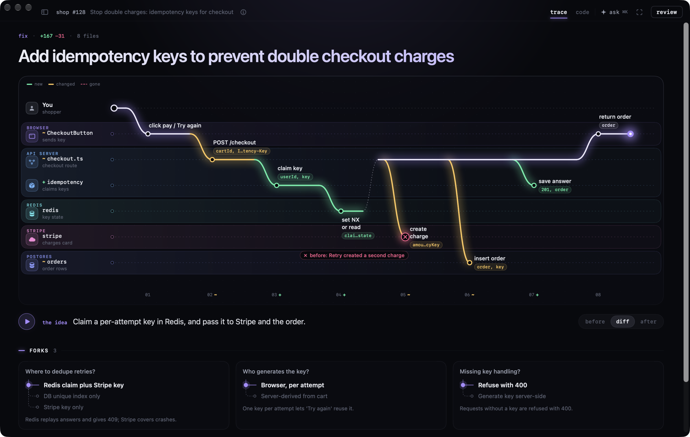
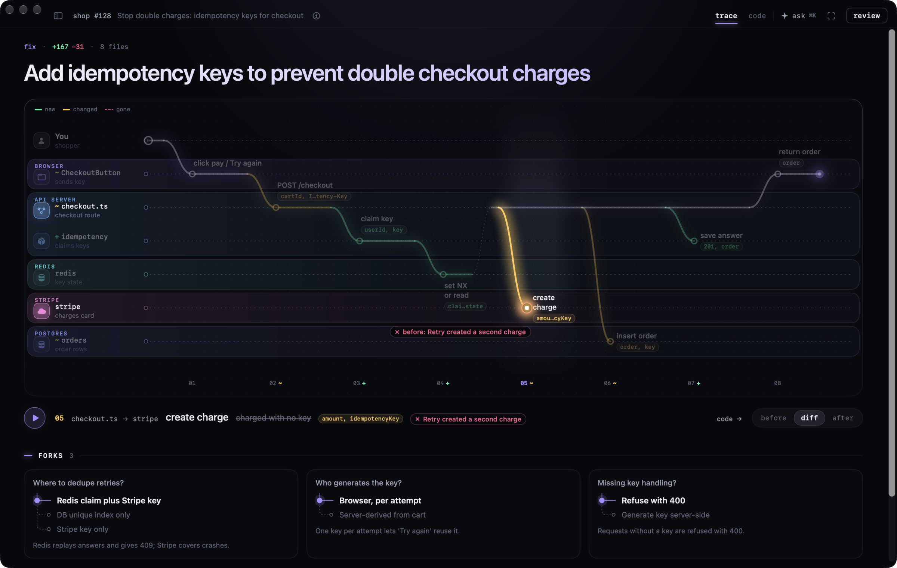
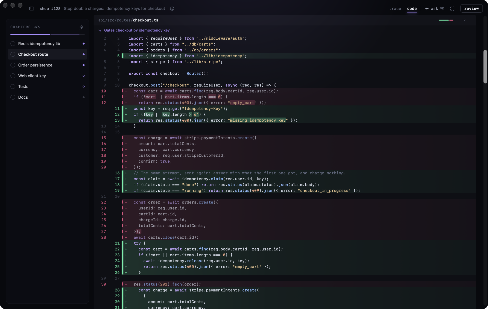

# Tracer

**Watch what a pull request does before you read it.** (Tracer is the app that was called Fathom.)

When an agent writes the code and a bot checks it does what it says, reading the diff line by line is no longer the
job. The job is judgement, and judgement starts with seeing what the change does. Tracer opens a pull request as a
picture: one request drawn as a single line of light travelling through the parts of the system, with the change
painted onto it. It draws; you think. It doesn't review the code, list risks or give advice: the questions are
yours. Then the code, in reading order. It runs on your own [GitHub CLI](https://cli.github.com) and
[Claude Code](https://code.claude.com), so there's no account, server or API key.



- **Trace**: one page, mostly picture.
  - **The line**: every part of the system is a rail, grouped into the process it runs in (the app, the server, a
    store, someone else's API), and time runs left to right. The request is one continuous line: it runs along a
    rail and crosses to another at each step. Where the change adds a step the line is green, where it changes one
    amber, a step it removes is a dashed red ghost, and a cross marks where things went wrong before. A few words
    sit beside each step with what travels there; everything else stays off the picture.
    A check that can stop the request (an access policy, a validator, a limit) is always a step of its own, on a
    rail marked with a shield, so you can see what happens before it and what never reaches it.
  - **One step at a time**: move the pointer over the stage and the step under it lights while the rest dims; the
    bar under the stage reads that step out (from, to, what it does, what it used to do, what travels). Click to
    pin it, `←` `→` to step like a debugger, `Space` to play the journey, `↩` to open the code behind the step.
    `B` `D` `A` switch between how it was, the diff, and how it is now.
  - **Forks**: up to three design decisions, each as a fork in the road: the branch the change took, the roads not
    taken, and why in a line. Pointing at one lights its step on the stage; a click opens its code.
  - **Chapters**: the diff as a ribbon of bars sized by how much there is to read; a click opens that chapter.


- **Code**: the whole diff in chapters marked *read*, *skim* or *skip*. The trace's line carries on down the gutter:
  a solid green rail beside what's new, a dashed rose one beside what's gone, the tint falling away to the right and
  removed code a little dimmer, so the eye lands on what the change adds. The conversations already on GitHub
  (people's and bots') sit on the lines they're about; click a line number to comment, reply in a thread, or suggest a
  change. Select code as in an editor (drag, double-click a word, triple-click a line, ⇧-click to extend; dragging
  past the edge scrolls) and copy it with `⌘C` or the right-click menu: the code as written, without line numbers
  or `+`/`−`.



- **Focus** (`⇧⌘F`): nothing on screen but the page. No sidebar, no bar, no chapter list.
- **Ask** (`⌘K`) puts the repo at the PR's head in front of Claude; **Review** posts your comments, replies and a
  verdict to GitHub as you.

It's quick: the first words are on screen a couple of seconds after you open a pull request, the line draws itself
as it's read, and the whole trace is there in about eight (Claude Sonnet, a 400-line change). A PR you've opened before opens at once.

## Install

1. With [Homebrew](https://brew.sh):

   ```sh
   brew install --cask yask123/tap/tracer
   ```

   or download [Tracer.dmg](https://github.com/yask123/tracer/releases/latest/download/Tracer.dmg) and drag Tracer to
   Applications. Signed and notarized; needs macOS 26 or later, Apple silicon or Intel. (Releases up to 0.7.0 on the
   [Releases](https://github.com/yask123/tracer/releases) page are the earlier app, Fathom.)
2. Open it. The first screen checks the two tools Tracer runs on and walks you through what's missing:
   - **GitHub CLI**: `brew install gh` ([other ways](https://cli.github.com)). Then press **Sign In to GitHub** in
     Tracer: it shows a one-time code, opens github.com, and finishes by itself. Already signed in with `gh auth login`?
     Nothing to do.
   - **Claude Code**: `curl -fsSL https://claude.ai/install.sh | bash` ([install guide](https://code.claude.com/docs/en/setup)).
     Then press **Open Terminal to Sign In**, or run `claude auth login` yourself. Readings use your Claude plan.

You can come back to this any time in **Settings** (`⌘,`), along with the model (Sonnet, the quick default, or Opus),
the appearance (neon on black by default; there's a paper one, and it can follow your Mac) and whether to trace new
review requests in the background so they open at once (off by default).

Tracer finds `gh` and `claude` the way your Terminal does: it reads your login shell's environment once at launch, so
Homebrew, nvm, mise, Volta, `~/.local/bin`, proxies, `GH_HOST` and `CLAUDE_CONFIG_DIR` all carry over.

## What leaves your Mac

- **GitHub**, through `gh` and your login: your inbox, the PRs you open, and, the first time you ask a question about
  one, a shallow checkout of its head commit so Claude can look around. A review is posted only when you submit it
  from the review sheet.
- **Claude**, through Claude Code on your plan: the diff. Questions (Ask) also get read-only
  access (`Read`, `Grep`, `Glob`) to that checkout. These runs leave out your MCP servers, hooks and slash commands.
- **Nothing else.** No analytics, no servers of its own. Readings, caches and checkouts stay in
  `~/Library/Application Support/Tracer` (Settings → Show in Finder). The first launch copies your inbox and recent
  pull requests over from Fathom's folder, if there is one, and leaves that folder alone.

## Using it

Paste a PR link or `owner/repo#123` into the field on the home screen or at the top of the inbox (`⌘L`), or pick one
from the inbox: PRs waiting for your review, your own, and ones you've reviewed.

Tracer registers `tracer://`. Save this as a bookmark and click it on any GitHub PR page:

```
javascript:location.href='tracer://'+location.href
```

| | |
|---|---|
| `⌘1` `⌘2` | Trace, Code |
| `Space`, `←` `→`, `↩`, `Esc` | play the journey, step through it, open the step's code, show the whole line again |
| point, click | light the step under the pointer; pin it (click again to let go) |
| `B` `D` `A` | the line before, as a diff, after |
| `⇧⌘F` | focus: only the page (`Esc` leaves) |
| `⌘K` | Ask Claude about the PR |
| `⌘↩` | Review |
| `J` `K`, `N` `P`, `X` | next and previous change, next and previous chapter, mark a chapter understood |
| click a line number | comment on that line; `⌘↩` adds it to your review, `Esc` closes the box and keeps what you typed |
| `⇧⌘R` | trace the PR again |
| `⇧⌘O` | open on GitHub |
| `⌘R` | refresh the inbox |
| `⌃⌘S` | show or hide the pull requests |

## Build from source

Needs the Xcode 27 command line tools. No Xcode project; `swiftc` builds the app straight from `Sources/`.

```sh
./build.sh            # build into build/Tracer.app (ad-hoc signed, for your own Mac)
./build.sh --run      # build and open
./build.sh --install  # build, copy to /Applications, launch
FATHOM_ARCHS="arm64 x86_64" ./build.sh   # universal
```

`scripts/release.sh <version> <build>` makes the notarized DMG in `dist/`. Publish it as a release asset named
`Tracer.dmg` (`gh release create v<version> dist/Tracer.dmg`), then `scripts/bump-tap.sh <version>` points the
Homebrew cask in `yask123/homebrew-tap` at it. It needs a Developer ID identity and a
`notarytool` profile, named by `FATHOM_SIGN_ID` and `FATHOM_NOTARY_PROFILE`, and the Mac unlocked while it runs (macOS
keeps the notary credentials out of reach while the screen is locked). The build switches keep the `FATHOM_` prefix
from the app's earlier name.

## How it works

| | |
|---|---|
| Setup | `Setup.swift` reads the login shell's environment, checks `gh api user` and `claude auth status`, and reads `claude --help` so an older Claude Code gets only the flags it understands. GitHub sign-in is `gh auth login --web` with the one-time code shown in the app |
| GitHub | `gh api graphql` for your repositories, a repository's open PRs, the inbox and PR details (with its review threads and conversation), `gh pr diff` for the diff, `gh api …/reviews` to post a review and `…/comments/{id}/replies` for replies |
| Trace | `claude -p --json-schema` over the diff with every hunk labelled (`f3h2`), written in the order it's drawn so the page fills in from the top: headline, kind, was / now / how, the cast (each part, its kind, what it does in three words, the process it runs in, whether it's new or changed), the flow (each step marked same, added, removed or changed, in four words, with what it was and the hunk it lives in, and where it broke), then up to three forks (the question, the branch taken, the roads not taken, why). The prompt asks for a drawing, not a review: no risks, advice, opinions or questions. Long prose and data files are trimmed to their first lines |
| Outline | in parallel, for the Code tab and the chapter ribbon: the hunks grouped into chapters in reading order, each marked read, skim or skip, and a few words on each change worth reading |
| The stage | `StagePlan` in `Trace.swift` turns the cast and the flow into geometry: a rail per part, a column per step, the line's runs and crossings, where each label fits without sitting on the line. `StageCanvas` draws it in one SwiftUI `Canvas` (bands, rails, a blurred glow under the line), revealed left to right as an animatable value, so the line draws itself and nothing is laid out per frame |
| Speed | both readings take the diff alone, at low effort, with no tools, so nothing waits on a checkout or a lookup, and each answer is short. On two 300 to 600-line pull requests with Sonnet: first words at 1.5 to 2.2 s, the trace done in 8.1 and 8.4 s, the outline in 4 to 7 s |
| Ask | `claude -p` with read-only `Read Grep Glob` in a shallow checkout of the PR head (`git fetch --depth=1 --filter=blob:none pull/N/head`, one worktree per PR, the 12 most recent kept), fetched the first time you ask |
| Cache | Claude's readings per PR commit in `soundings/`, each PR's details and diff in `prs/`, and the inbox in `state.json`, all under `~/Library/Application Support/Tracer`. The top of the inbox is fetched ahead in the background |

Sources: `Setup.swift` (accounts), `Shell.swift` (child processes), `GitHub.swift`, `Diff.swift` (parser, noise
rules), `Claude.swift` (CLI stream, partial JSON), `Analyst.swift` (prompts and schemas), `Models.swift` (the trace
and the outline), `Library.swift` (caches, checkouts), `Store.swift` (state), and the views: `Trace.swift`
(the header, the stage and its line, the bar that reads a step out, forks, the chapter ribbon), `Render.swift` (the
trace drawn off screen to a picture, and the layout check), `PRView.swift` (the bar, focus), `RootView.swift`
(the repository and its pull requests), `ChangesView.swift` (the Code tab), `CodeChunk.swift` (the diff's lines,
drawn with Core Text a run of two dozen at a time, rather than one SwiftUI view per line, so the Code tab scrolls
smoothly), `Theme.swift` (the look). The continuous motion (the scan line, pings) is Core Animation in
`CoreAnimated.swift`, so the app does no work per frame.

## QA switches

Environment variables for screenshots and tests (`tools/shoot.sh out.png VAR=value …` launches a separate instance
with them and captures its window; `SHOOT_QUIET=1` leaves it where it opens instead of pulling it to the front):

| | |
|---|---|
| `FATHOM_OPEN=owner/repo#123` | open a PR on launch |
| `FATHOM_HOME=/path` | use another data folder |
| `FATHOM_SETUP=gh:signedOut,claude:missing` | show a setup state without touching the real tools; add `signin`, with `GH_CONFIG_DIR` set to an empty folder, to try GitHub sign-in |
| `FATHOM_SETTINGS=1` | open Settings on launch |
| `FATHOM_NO_AI=1` | don't call Claude |
| `FATHOM_NO_CHECKOUT=1`, `FATHOM_NO_PREFETCH=1` | no checkout of the repo; no fetching ahead |
| `FATHOM_TAB=changes`, `FATHOM_BY_FILE=1` | start on a view |
| `FATHOM_FLOW=before`, `FATHOM_STEP=3` | show the line before (or `after`) instead of as a diff; open it with a step pinned (counting from 0) |
| `FATHOM_SECTION=end`, `FATHOM_FOCUS=1` | open the trace scrolled to its end (forks, chapters); open in focus |
| `FATHOM_RENDER=/out.png`, `FATHOM_RENDER_PR=owner/repo#123` | draw the trace page of a pull request that's already on disk to a picture, off screen, and quit: no window ever opens. With it: `FATHOM_RENDER_WIDTH=1500`, `FATHOM_FLOW`, `FATHOM_STEP`, `FATHOM_APPEARANCE`, `FATHOM_REVEAL=4.5` (the line drawn that many steps in), `FATHOM_READ=1` (have Claude read the PR first, keep the reading and print how long it took), `FATHOM_LINT=1` (lay the stage out at three widths in all three tellings and report any label that overlaps another, sits under the tag for what broke, or leaves the stage) and `FATHOM_STAGE_JSON=/out.json` with `FATHOM_STAGE_WIDTH=1180` (write the stage's geometry in all three tellings, colours as hex and paths as SVG, for the website's live trace) |
| `FATHOM_QUIET=1` | for checks while the Mac is in use: the window takes no clicks and no keys, stays out of the Dock and the app switcher, and sits in a corner of the screen with a sliver showing |
| `FATHOM_STAGETEST=4` (or `play`), `FATHOM_STILL=1` | click the trace's fourth column (or the play button) with a synthetic press and release, and write what got pinned to `FATHOM_BENCH_OUT`; draw everything as it ends up, with nothing moving |
| `FATHOM_SCROLL=line:f4h1:90`, `FATHOM_GO=f3h2` | jump in the Code tab |
| `FATHOM_ASK="…"` (empty just opens it), `FATHOM_REVIEW=1`, `FATHOM_INFO=1` | ask a question, open the review sheet, open the details and conversation |
| `FATHOM_COMMENT=path:line`, `FATHOM_DRAFT="…"`, `FATHOM_ADD=1`, `FATHOM_REPLY=<thread id>` | open a comment box on a line (filled, or added to the review), or a reply in a thread |
| `FATHOM_WINDOW=1188x884`, `FATHOM_NO_HOVER=1` | size the window; ignore the pointer (clean screenshots) |
| `FATHOM_SIDEBAR=0`, `FATHOM_MUTE=1` | hide the sidebar, no sound when a trace is ready |
| `FATHOM_APPEARANCE=light` | show the light (or `dark`) appearance without changing the saved choice |
| `FATHOM_DUMP_PROMPT=/path` | write the reading prompt to a file |
| `FATHOM_SELECTTEST=1`, `FATHOM_PASTEBOARD=name`, `FATHOM_TRACE_SELECT=1` | select and copy in the Code tab by itself with synthetic clicks, drags and ⌘C, check what was copied (into a private pasteboard, so yours is untouched) and write the results to `FATHOM_BENCH_OUT`; log what the selection does |
| `FATHOM_SCROLLBENCH=2400,7000` | scroll the Code tab by itself at those speeds (points per second), report late frames to stderr (and to `FATHOM_BENCH_OUT`), and quit. `tools/bench.sh out.json VAR=value …` runs it |

## License

[MIT](LICENSE)
