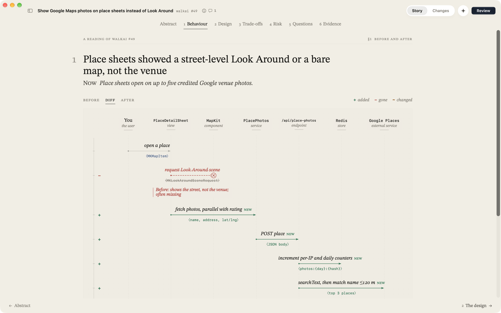

# Fathom

**Read a pull request as a short paper you referee.**

When an agent writes the code and a bot checks it does what it says, reading the diff line by line is no longer the
job. The job is judgement: what was wrong, how the system behaves now, the idea it rests on, what it trades away, what
could go wrong, and what's still open. Fathom lays that out the way a good paper does, a page at a time, each with one
sentence and one figure, the code one click away, and nothing about the inner workings you don't need. It runs on your
own [GitHub CLI](https://cli.github.com) and [Claude Code](https://code.claude.com), so there's no Fathom account,
server or API key.


- **Abstract**: the headline, the change's vital signs (what kind of change; a one-way or two-way door, that is,
  whether a revert undoes it; how risky; how far it reaches; what's still open), and the whole PR in three run-in
  sentences: *Problem*, *Move*, *Price*.
- **Behaviour**: one journey through the system, before and after, as a single sequence diagram. Switch between
  *Before*, *After* and *Diff*: in the diff a gutter marks each step the way a code diff marks lines (+ added, − gone,
  ~ changed), with what a step used to do struck through, and red marks where it went wrong.
- **Design**: the key idea in a sentence, and a blueprint of where each part runs. Each process (the app, the server,
  a third party) is a box; arrows say what crosses between parts, and the crossings of a process boundary are marked.
  Under it, **Box 1** teaches the engineering idea the change rests on (what it is in general, how this change uses
  it, where else you've met it), and a nomenclature defines the names a newcomer would trip on.
- **Trade-offs**: the main thing the change gives up, in a line, and each design decision as a ruled table: the
  options as columns, what separates them as rows, scored with Harvey balls, the road taken shaded, and why it won,
  marked when the PR says so and when it's inferred.
- **Risk**: whether it's a one-way or a two-way door and why; each hazard on a likelihood × impact matrix with its
  trigger, who'd notice, and what in the change guards it (filled marks have nothing guarding them); and the
  contracts whose shape changes, member by member.
- **Questions**: the two to four questions the diff leaves open. Settle each yourself, have Fathom look into it in the
  repository, or put it to the author: a comment box opens on the code with the question written in.
- **Evidence**: the passages to read if you read nothing else, with notes in the margin beside the lines they're
  about.

Around the story, the app stays out of the way: pick a repository, see its open pull requests (or only the ones
waiting for you), pick one. **Changes** has the whole diff in chapters marked *read*, *skim* or *skip*, with the
conversations already on GitHub (people's and bots') on the lines they're about; click a line number to comment, reply
in a thread, or suggest a change. **Ask** (`⌘K`) puts the repo at the PR's head in front of Claude; **Review** posts
your comments, replies and a verdict to GitHub as you. A PR you've read before opens instantly; a new one's pages fill in
as Claude writes them, the drawings within half a minute and the referee's pages within a minute or so.



## Install

1. Download [**Fathom.dmg**](https://github.com/yask123/fathom/releases/latest/download/Fathom.dmg) (or pick a version
   from [Releases](https://github.com/yask123/fathom/releases)) and drag Fathom into Applications. It's signed and
   notarized by Apple. Needs macOS 26 or later (Apple silicon or Intel).
2. Open it. The first screen checks the two tools Fathom runs on and walks you through what's missing:
   - **GitHub CLI**: `brew install gh` ([other ways](https://cli.github.com)). Then press **Sign In to GitHub** in
     Fathom: it shows a one-time code, opens github.com, and finishes by itself. Already signed in with `gh auth login`?
     Nothing to do.
   - **Claude Code**: `curl -fsSL https://claude.ai/install.sh | bash` ([install guide](https://code.claude.com/docs/en/setup)).
     Then press **Open Terminal to Sign In**, or run `claude auth login` yourself. Readings use your Claude plan.

You can come back to this any time in **Settings** (`⌘,`), along with the model (Opus or Sonnet), the appearance
(light, on warm paper, or dark; it follows your Mac unless you pick one) and whether to read new review requests in
the background (off by default).

Fathom finds `gh` and `claude` the way your Terminal does: it reads your login shell's environment once at launch, so
Homebrew, nvm, mise, Volta, `~/.local/bin`, proxies, `GH_HOST` and `CLAUDE_CONFIG_DIR` all carry over.

## What leaves your Mac

- **GitHub**, through `gh` and your login: your inbox, the PRs you open, and a shallow checkout of a PR's head commit
  so Claude can look around. A review is posted only when you submit it from the review sheet.
- **Claude**, through Claude Code on your plan: the diff, and read-only access (`Read`, `Grep`, `Glob`) to that
  checkout. These runs leave out your MCP servers, hooks and slash commands.
- **Nothing else.** No analytics, no Fathom servers. Readings, caches and checkouts stay in
  `~/Library/Application Support/Fathom` (Settings → Show in Finder).

## Using it

Paste a PR link or `owner/repo#123` into the field on the home screen or at the top of the inbox (`⌘L`), or pick one
from the inbox: PRs waiting for your review, your own, and ones you've reviewed.

Fathom registers `fathom://`. Save this as a bookmark and click it on any GitHub PR page:

```
javascript:location.href='fathom://'+location.href
```

| | |
|---|---|
| `⌘1` `⌘2` | Story, Changes |
| `←` `→` | turn the story's pages |
| `⌘K` | Ask Claude about the PR |
| `⌘↩` | Review |
| `J` `K`, `N` `P`, `X` | next and previous change, next and previous chapter, mark a chapter understood |
| click a line number | comment on that line; `⌘↩` adds it to your review, `Esc` closes the box and keeps what you typed |
| `⇧⌘R` | read the PR again |
| `⇧⌘O` | open on GitHub |
| `⌘R` | refresh the inbox |
| `⌃⌘S` | show or hide the inbox |

## Build from source

Needs the Xcode 27 command line tools. No Xcode project; `swiftc` builds the app straight from `Sources/`.

```sh
./build.sh            # build into build/Fathom.app (ad-hoc signed, for your own Mac)
./build.sh --run      # build and open
./build.sh --install  # build, copy to /Applications, launch
FATHOM_ARCHS="arm64 x86_64" ./build.sh   # universal
```

`scripts/release.sh <version> <build>` makes the notarized DMG in `dist/`. It needs a Developer ID identity and a
`notarytool` profile, named by `FATHOM_SIGN_ID` and `FATHOM_NOTARY_PROFILE`, and the Mac unlocked while it runs (macOS
keeps the notary credentials out of reach while the screen is locked). Upload the DMG to the release as `Fathom.dmg`
so the download link above keeps pointing at the newest one.

## How it works

| | |
|---|---|
| Setup | `Setup.swift` reads the login shell's environment, checks `gh api user` and `claude auth status`, and reads `claude --help` so an older Claude Code gets only the flags it understands. GitHub sign-in is `gh auth login --web` with the one-time code shown in the app |
| GitHub | `gh api graphql` for your repositories, a repository's open PRs, the inbox and PR details (with its review threads and conversation), `gh pr diff` for the diff, `gh api …/reviews` to post a review and `…/comments/{id}/replies` for replies |
| Outline | `claude -p --json-schema` over the diff with every hunk labelled (`f3h2`): headline, chapters, the interfaces whose shape changes, one note per hunk. Long prose and data files are trimmed to their first lines. Streams in, headline first |
| Story | the drawing: the problem and the situation after, one journey with every step marked same, added, removed or changed (and what it was), where it broke, the move, the parts with where each runs and what crosses between them, the concept it rests on, and the terms. `claude -p --json-schema` with read-only `Read Grep Glob` in a shallow checkout of the PR head (`git fetch --depth=1 --filter=blob:none pull/N/head`, one worktree per PR, the 12 most recent kept). It waits at most 1.5 s for the checkout, else works from the diff alone; pages fill in as they're written |
| Critique | the referee, in parallel with the story and told never to invent problems or give generic advice: the price, each decision's options scored on what separates them, the door, the hazards (likelihood, impact, trigger, effect, guard), the open questions, and the passages to read with margin notes anchored to exact lines |
| Cache | Claude's readings per PR commit in `soundings/`, each PR's details and diff in `prs/`, and the inbox in `state.json`, all under `~/Library/Application Support/Fathom`. The top of the inbox is fetched ahead in the background |

Sources: `Setup.swift` (accounts), `Shell.swift` (child processes), `GitHub.swift`, `Diff.swift` (parser, noise
rules), `Claude.swift` (CLI stream, partial JSON), `Analyst.swift` (prompts and schemas), `Library.swift` (caches,
checkouts), `Store.swift` (state), and the views: `Story.swift` (the abstract and the behaviour diagram),
`Design.swift` (the blueprint, Box 1), `Referee.swift` (trade-offs, risk, questions, evidence), `RootView.swift` (the repository and its pull requests), `ChangesView.swift`. The continuous motion
(sonar, pings) is Core Animation in `CoreAnimated.swift`, so the app does no work per frame.

## QA switches

Environment variables for screenshots and tests (`tools/shoot.sh out.png VAR=value …` launches a separate instance
with them and captures its window; `SHOOT_QUIET=1` leaves it where it opens instead of pulling it to the front):

| | |
|---|---|
| `FATHOM_OPEN=owner/repo#123` | open a PR on launch |
| `FATHOM_HOME=/path` | use another data folder |
| `FATHOM_SETUP=gh:signedOut,claude:missing` | show a setup state without touching the real tools; add `signin`, with `GH_CONFIG_DIR` set to an empty folder, to try GitHub sign-in |
| `FATHOM_SETTINGS=1` | open Settings on launch |
| `FATHOM_NO_AI=1` | don't call Claude |
| `FATHOM_NO_CHECKOUT=1`, `FATHOM_NO_PREFETCH=1` | no checkout of the repo; no fetching ahead |
| `FATHOM_TAB=changes`, `FATHOM_BY_FILE=1` | start on a view |
| `FATHOM_PAGE=design` | open the story on a page (abstract, behaviour, design, tradeoffs, risk, questions, evidence) |
| `FATHOM_FLOW=before`, `FATHOM_STORY_END=1` | show the behaviour figure before (or `after`) instead of as a diff; open pages scrolled to the end |
| `FATHOM_SCROLL=line:f4h1:90`, `FATHOM_GO=f3h2` | jump in Changes |
| `FATHOM_ASK="…"` (empty just opens it), `FATHOM_REVIEW=1`, `FATHOM_INFO=1` | ask a question, open the review sheet, open the details and conversation |
| `FATHOM_COMMENT=path:line`, `FATHOM_DRAFT="…"`, `FATHOM_ADD=1`, `FATHOM_REPLY=<thread id>` | open a comment box on a line (filled, or added to the review), or a reply in a thread |
| `FATHOM_QUESTION=0` | put the reading's first question (or another, counting from 0) to the author |
| `FATHOM_WINDOW=1188x884`, `FATHOM_NO_HOVER=1` | size the window; ignore the pointer (clean screenshots) |
| `FATHOM_SIDEBAR=0`, `FATHOM_MUTE=1` | hide the sidebar, no sonar ping |
| `FATHOM_APPEARANCE=light` | show the light (or `dark`) appearance without changing the saved choice |
| `FATHOM_DUMP_PROMPT=/path` | write the reading prompt to a file |

## Website

`site/fathom/` is the page at [yask.dev/fathom](https://yask.dev/fathom): one HTML file and screenshots of the app.
Preview with `python3 -m http.server 4360 --directory site` and open `/fathom/`.

## License

[MIT](LICENSE)
