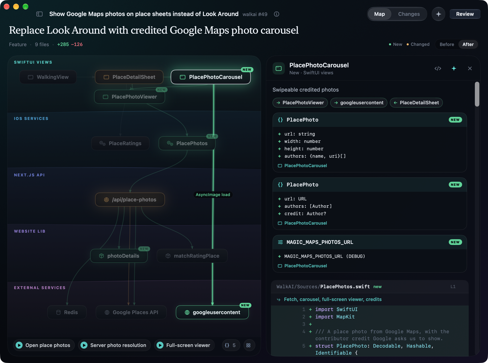
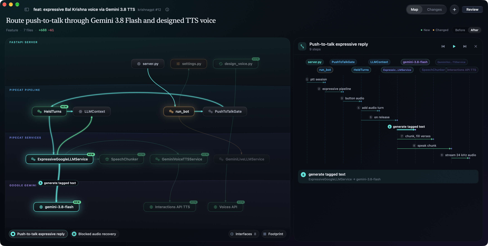

# Fathom

**Understand a pull request before you read it.**

A native Mac app that turns a pull request into a map of the system it changes: which parts it touches, how a request
moves through them, and every hunk one click away. It runs on your own tools, the [GitHub CLI](https://cli.github.com)
and [Claude Code](https://code.claude.com), so there's no Fathom account, server or API key.



When an agent writes the code, the line-by-line is usually fine. What a reviewer still owns is understanding what the
change does, how it moves through the system, and the architectural call nobody else will catch. Fathom shows that as
diagrams and leaves the judgement to you: no AI verdicts, no risk scores, labels instead of paragraphs.

- **The map.** One line on what the PR does, then the layers it cuts through, drawn as strata from the surface (screens,
  routes) down to the depths (stores, external APIs). New parts glow green, changed ones amber. **Before / After**
  shows how the architecture moved.
- **Every wire says how and what.** Calls are solid, network requests dashed, events dotted, store reads and writes
  dash-dotted, and the connections a PR changes carry a tag with what travels (`POST query, context → RouteIntent`).
  Click a wire for the call as written, what goes and what comes back, the interfaces it carries, and the code where
  it happens.
- **Click a part** and its code opens beside the map: the state it holds, each connection with its call and payload,
  the interfaces it owns, and every hunk in its files with a short note on each.
- **Flows.** Play one and a pulse runs along the wires while its sequence diagram follows in the panel, each step
  labelled with the data it carries.
- **Interfaces** whose shape changes (endpoints, types, tables, config) and the **footprint** of the change.
- **Changes**: the whole diff, regrouped into chapters marked *read*, *skim* or *skip*.
- **Ask** (`⌘K`) with the repo at the PR's head in front of Claude; any `file:line` in the answer jumps into the diff.
- **Review**: line comments and a summary, then Comment, Approve or Request changes, posted to GitHub as you.

A PR you've opened before opens instantly from disk. A new one shows its headline within seconds and draws its map
as Claude writes it.



## Install

1. Download [**Fathom.dmg**](https://github.com/yask123/fathom/releases/latest/download/Fathom.dmg) (or pick a version
   from [Releases](https://github.com/yask123/fathom/releases)) and drag Fathom into Applications. It's signed and
   notarized by Apple. Needs macOS 26 or later (Apple silicon or Intel).
2. Open it. The first screen checks the two tools Fathom runs on and walks you through what's missing:
   - **GitHub CLI**: `brew install gh` ([other ways](https://cli.github.com)). Then press **Sign In to GitHub** in
     Fathom: it shows a one-time code, opens github.com, and finishes by itself. Already signed in with `gh auth login`?
     Nothing to do.
   - **Claude Code**: `curl -fsSL https://claude.ai/install.sh | bash` ([install guide](https://code.claude.com/docs/en/setup)).
     Then press **Open Terminal to Sign In**, or run `claude auth login` yourself. Readings use your Claude plan.

You can come back to this any time in **Settings** (`⌘,`), along with the model (Opus or Sonnet) and whether to read
new review requests in the background (off by default).

Fathom finds `gh` and `claude` the way your Terminal does: it reads your login shell's environment once at launch, so
Homebrew, nvm, mise, Volta, `~/.local/bin`, proxies, `GH_HOST` and `CLAUDE_CONFIG_DIR` all carry over.

## What leaves your Mac

- **GitHub**, through `gh` and your login: your inbox, the PRs you open, and a shallow checkout of a PR's head commit
  so Claude can look around. A review is posted only when you submit it from the review sheet.
- **Claude**, through Claude Code on your plan: the diff, and read-only access (`Read`, `Grep`, `Glob`) to that
  checkout. These runs leave out your MCP servers, hooks and slash commands.
- **Nothing else.** No analytics, no Fathom servers. Readings, caches and checkouts stay in
  `~/Library/Application Support/Fathom` (Settings → Show in Finder).

## Using it

Paste a PR link or `owner/repo#123` into the field on the home screen or at the top of the inbox (`⌘L`), or pick one
from the inbox: PRs waiting for your review, your own, and ones you've reviewed.

Fathom registers `fathom://`. Save this as a bookmark and click it on any GitHub PR page:

```
javascript:location.href='fathom://'+location.href
```

| | |
|---|---|
| `⌘1` `⌘2` | Map, Changes |
| `⌘K` | Ask Claude about the PR |
| `⌘↩` | Review |
| `J` `K`, `N` `P`, `X` | next and previous change, next and previous chapter, mark a chapter understood |
| `⇧⌘R` | read the PR again |
| `⇧⌘O` | open on GitHub |
| `⌘R` | refresh the inbox |
| `⌃⌘S` | show or hide the inbox |

## Build from source

Needs the Xcode 27 command line tools. No Xcode project; `swiftc` builds the app straight from `Sources/`.

```sh
./build.sh            # build into build/Fathom.app (ad-hoc signed, for your own Mac)
./build.sh --run      # build and open
./build.sh --install  # build, copy to /Applications, launch
FATHOM_ARCHS="arm64 x86_64" ./build.sh   # universal
```

`scripts/release.sh <version> <build>` makes the notarized DMG in `dist/`. It needs a Developer ID identity and a
`notarytool` profile, named by `FATHOM_SIGN_ID` and `FATHOM_NOTARY_PROFILE`, and the Mac unlocked while it runs (macOS
keeps the notary credentials out of reach while the screen is locked). Upload the DMG to the release as `Fathom.dmg`
so the download link above keeps pointing at the newest one.

## How it works

| | |
|---|---|
| Setup | `Setup.swift` reads the login shell's environment, checks `gh api user` and `claude auth status`, and reads `claude --help` so an older Claude Code gets only the flags it understands. GitHub sign-in is `gh auth login --web` with the one-time code shown in the app |
| GitHub | `gh api graphql` for the inbox and PR details, `gh pr diff` for the diff, `gh api …/reviews` to post a review |
| Outline | `claude -p --json-schema` over the diff with every hunk labelled (`f3h2`): headline, chapters, the interfaces whose shape changes, one note per hunk. Long prose and data files are trimmed to their first lines. Streams in, headline first |
| Map | layers; parts with the state they hold; connections with how they're made (call, async, http, event, read, write, render), the call as written, what's sent and returned, and the hunks that make them; flows with the data on each step. `claude -p` with read-only `Read Grep Glob` in a shallow checkout of the PR head (`git fetch --depth=1 --filter=blob:none pull/N/head`, one worktree per PR, the 12 most recent kept). It waits at most 1.5 s for the checkout, else draws from the diff alone; parts appear as they're written |
| Cache | Claude's readings per PR commit in `soundings/`, each PR's details and diff in `prs/`, and the inbox in `state.json`, all under `~/Library/Application Support/Fathom`. The top of the inbox is fetched ahead in the background |

Sources: `Setup.swift` (accounts), `Shell.swift` (child processes), `GitHub.swift`, `Diff.swift` (parser, noise
rules), `Claude.swift` (CLI stream, partial JSON), `Analyst.swift` (prompts and schemas), `Library.swift` (caches,
checkouts), `Store.swift` (state), and the views: `MapView.swift` and `StrataMap.swift` (the map, each band, wire and
node its own view so layout changes glide), `Panels.swift` (the side panel), `ChangesView.swift`. The continuous
motion (sonar, pings, a flow's pulse) is Core Animation in `CoreAnimated.swift`, so the app does no work per frame.

## QA switches

Environment variables for screenshots and tests (`tools/shoot.sh out.png VAR=value …` launches a separate instance
with them and captures its window):

| | |
|---|---|
| `FATHOM_OPEN=owner/repo#123` | open a PR on launch |
| `FATHOM_HOME=/path` | use another data folder |
| `FATHOM_SETUP=gh:signedOut,claude:missing` | show a setup state without touching the real tools; add `signin`, with `GH_CONFIG_DIR` set to an empty folder, to try GitHub sign-in |
| `FATHOM_SETTINGS=1` | open Settings on launch |
| `FATHOM_NO_AI=1` | don't call Claude |
| `FATHOM_NO_CHECKOUT=1`, `FATHOM_NO_PREFETCH=1` | no checkout of the repo; no fetching ahead |
| `FATHOM_TAB=changes`, `FATHOM_ERA=before`, `FATHOM_BY_FILE=1` | start on a view |
| `FATHOM_SELECT=<component id>`, `FATHOM_EDGE=<from id>><to id>`, `FATHOM_PANEL=interfaces\|footprint` | open the side panel |
| `FATHOM_FLOW=0`, `FATHOM_FLOW_STEP=3` | play a flow, stop at a step |
| `FATHOM_SCROLL=line:f4h1:90`, `FATHOM_GO=f3h2` | jump in Changes |
| `FATHOM_ASK="…"` (empty just opens it), `FATHOM_REVIEW=1` | ask a question, open the review sheet |
| `FATHOM_WINDOW=1188x884`, `FATHOM_NO_HOVER=1` | size the window; ignore the pointer (clean screenshots) |
| `FATHOM_SIDEBAR=0`, `FATHOM_MUTE=1` | hide the inbox, no sonar ping |
| `FATHOM_DUMP_PROMPT=/path` | write the reading prompt to a file |

## Website

`site/fathom/` is the page at [yask.dev/fathom](https://yask.dev/fathom): one HTML file and screenshots of the app.
Preview with `python3 -m http.server 4360 --directory site` and open `/fathom/`.

## License

[MIT](LICENSE)
